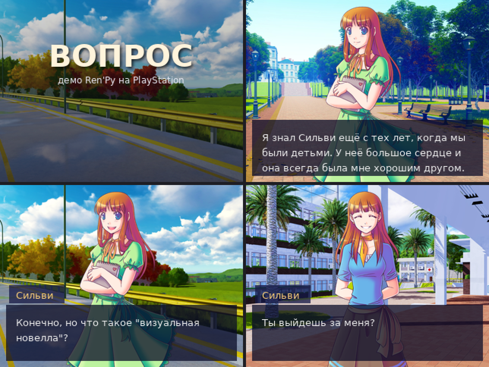

# ps1-vn-engine

Движок визуальных новелл для оригинальной PlayStation. Сценарий пишется на
простом текстовом языке, картинки — обычные PNG, музыка — MIDI, а на выходе
получается образ диска, который запускается на живой приставке.



*Макет кадров демо-игры, отрисованный по настоящим данным сборки: тем же
шрифтом, теми же переносами строк и картинками, что попадают на диск.*

## Что умеет

- **Текст** с эффектом печатной машинки, кириллица и латиница, переносы
  считаются при сборке, длинные реплики сами делятся на страницы.
- **Фоны и до четырёх персонажей** на экране, спрайты с мягким краем.
- **Анимированные фоны** до четырёх кадров.
- **Экранные эффекты**: затемнение, тряска, вспышка, тонирование, сдвиг.
- **Ветвление**: выборы, переходы, 256 флагов сюжета.
- **Музыка** из MIDI через звуковой процессор: играет непрерывно, даже
  пока грузятся картинки. Тянущиеся инструменты зациклены, банк можно
  собрать из свободных SoundFont.
- **Звуковые эффекты** на отдельных голосах, музыку не перебивают.
- **Озвучка** XA: тысячи реплик в одном файле с чередованием каналов.
- **Видео** STR через аппаратный декодер MDEC.
- **Сохранения** на карту памяти с иконкой, четыре слота, по главам.
- **Галерея** открытых сцен, копится между прохождениями.
- **Импорт из Ren'Py** для простых игр.
- **Релизная сборка** без отладочных средств.

## Где работает

| Платформа | Состояние |
|---|---|
| PlayStation, записанный CD-R | работает |
| PlayStation с PicoStation (ODE) | работает |
| Встроенный эмулятор PS3 | работает |
| DuckStation, PCSX-Redux | работают |
| PS2 через POPS | не поддерживается |

Подробности и найденные по дороге различия между платформами —
в [docs/platforms.md](docs/platforms.md).

## Быстрый старт

Нужны [PSn00bSDK](https://github.com/Lameguy64/PSn00bSDK) (проверено на
готовом релизе 0.24 для Linux: GCC 12.3.0, mkpsxiso 2.03), Python 3 с
Pillow и шрифт DejaVu Sans (`fonts-dejavu-core`).

```bash
export PSN00BSDK_LIBS=/путь/к/sdk/lib/libpsn00b

python3 tools/build_data.py
cmake -S . -B build -G Ninja -DCMAKE_TOOLCHAIN_FILE=$PSN00BSDK_LIBS/cmake/sdk.cmake
cmake --build build
```

Получится `build/vn.bin` и `build/vn.cue` — образ демо-игры. Подробно об
установке, релизной сборке и записи на диск — в
[docs/building.md](docs/building.md).

## Демо-игра

В репозиторий входит «Вопрос» — перенос демо *The Question*, которое
поставляется вместе с [Ren'Py](https://github.com/renpy/renpy). Ассеты
распространяются под лицензией MIT, русский перевод взят из той же
поставки. Перенос сделан инструментом `tools/import_renpy.py` и доработан
руками, чтобы показать возможности движка: титульное меню с загрузкой и
галереей, главы для сохранений, анимированный дождь в плохом финале,
тряска и звуковой эффект в сцене предложения. Музыка написана заново для
этого репозитория.

Авторы и лицензии ассетов — в [CREDITS.md](CREDITS.md).

## Лицензия

Движок, инструменты и документация — [MIT](LICENSE): используйте,
меняйте и распространяйте как угодно, в том числе в коммерческих играх.
Ассеты демо-игры тоже под MIT, их авторы перечислены в
[CREDITS.md](CREDITS.md).

## Документация

| Документ | О чём |
|---|---|
| [docs/scenario.md](docs/scenario.md) | язык сценария, все команды с примерами |
| [docs/building.md](docs/building.md) | установка, сборка, релиз, запись диска |
| [docs/assets.md](docs/assets.md) | картинки, музыка, инструменты, озвучка, видео, импорт из Ren'Py |
| [docs/architecture.md](docs/architecture.md) | устройство движка, память, видеопамять, звук, сохранения |
| [docs/formats.md](docs/formats.md) | форматы файлов на диске и на карте памяти, опкоды |
| [docs/platforms.md](docs/platforms.md) | совместимость, коды ошибок, отладка на железе |

## Устройство репозитория

```
src/            движок на C (PSn00bSDK)
tools/          сборка данных и вспомогательные инструменты на Python
script/main.vns сценарий
art/            картинки: bg/ фоны, char/ персонажи, scene/ анимация
music/          MIDI
instruments.txt банк инструментов и звуковых эффектов
music.txt       список треков
game.txt        название, имя сохранения, метка тома
save_icon.png   иконка сохранения
iso.xml         описание образа диска (список файлов дописывает сборка)
docs/           документация
```
